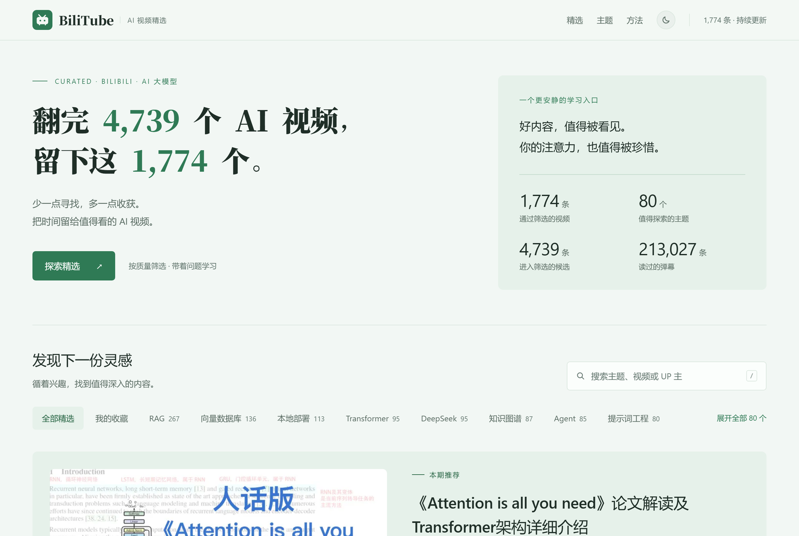
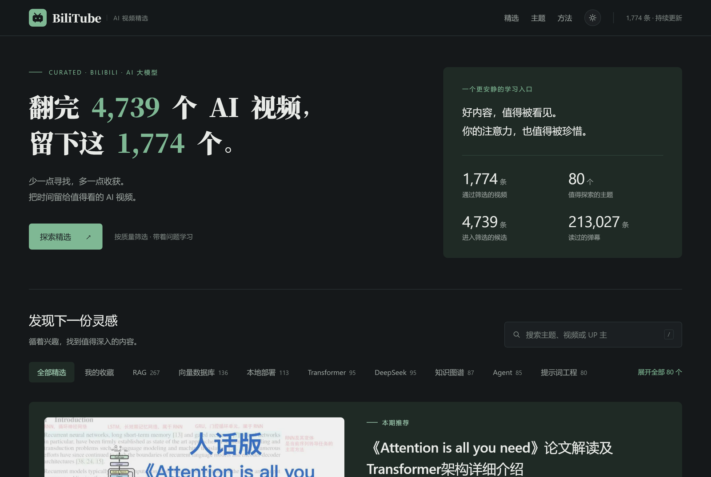

<!-- markdownlint-disable MD041 -->

<div align="center">

# BiliTube

**翻完 4,739 个 B 站 AI 视频，留下这 1,774 个。**

少一点寻找，多一点收获。把时间留给值得看的 AI 视频。

[在线站点](https://www.51bilitube.com) · [问题反馈](https://github.com/zhaoxuejie/moqian-bilitube/issues) · [设计决策](docs/architecture.md)

[](https://github.com/zhaoxuejie/moqian-bilitube/actions/workflows/ci.yml)
[](https://github.com/zhaoxuejie/moqian-bilitube/releases)
[](LICENSE)



</div>

---

## 这是什么

B 站的 AI 大模型视频多到看不完：同一个话题有几十个版本，播放量高的未必讲得清楚，
讲得清楚的又常常没人看。

BiliTube 做的是**先筛后排**：从 4,739 个候选里按相关性、时长、分区硬过滤，
再按「分区 × 时长档」做分位归一打分，最后由大模型读完简介与弹幕逐条写判断，
留下 1,774 个值得花时间的，做成一个能按主题、难度、时效筛选的静态站点。

**它不推荐最火的，它推荐最值得看的。**

## 效果

数据每周更新一次，下面是 **2026-11-10** 那次更新的快照：

| 指标 | 数值 |
| ---- | ---- |
| 进入筛选的候选 | 4,739 条 |
| 最终精选 | 1,774 条 |
| 覆盖主题 | 80 个 |
| 读过的弹幕样本 | 213,027 条 |

<details>
<summary>深色模式</summary>



</details>

## 快速开始

三种人，三条路。

### 只想看内容

直接打开 [www.51bilitube.com](https://www.51bilitube.com)。

### 想本地跑站点（用仓库里的数据快照）

```bash
git clone https://github.com/zhaoxuejie/moqian-bilitube.git
cd moqian-bilitube

npm --prefix web ci
npm --prefix web run build        # 产物在 web/out
python -m http.server 4173 --directory web/out
```

打开 <http://127.0.0.1:4173> 即可。数据快照（`web/public/data/*.json`）随仓库提供，不需要爬虫。

### 想跑完整流水线（自己采集、打分、生成卡片）

```bash
python -m venv .venv
.venv\Scripts\activate            # macOS / Linux: source .venv/bin/activate
pip install -r requirements.txt

copy .env.example .env            # 填 LLM_API_KEY（生成卡片必填）
```

然后准备一份配方（见 [配方](#配方preset)），跑一次全流程：

```bash
python -m bilitube collect search --preset presets/example --max-pages 3
python -m bilitube collect enrich
python -m bilitube filter
python -m bilitube score
python -m bilitube collect danmaku
python -m bilitube card
python -m bilitube export --out web/public/data
```

> 仓库里**没有**真实配方（关键词、词表、权重、提示词）和数据库，只有
> `presets/example/` 示例和导出的数据快照。想复刻线上效果要自己调配方。

## 目录结构

```text
moqian-bilitube/
├── bilitube/                  # Python 流水线（引擎）
│   ├── http.py                # 限速 0.8rps、重试、风控识别
│   ├── db.py                  # SQLite schema、幂等写入、断点续采
│   ├── collector.py           # 搜索 / 详情补齐 / 弹幕采集
│   ├── filter.py              # 词表 + 分区白名单 + 时长与配额
│   ├── scoring.py             # 分位归一与机器分
│   ├── llm.py                 # 卡片生成与内容分回写
│   ├── preset.py              # 配方加载与校验
│   ├── export.py              # 导出站点 JSON
│   └── cli.py                 # 命令行入口
├── presets/                   # 配方：关键词、规则、权重、提示词
│   └── example/               # 最小可用示例
├── web/                       # Next.js 静态站点
│   ├── app/                   # 首页 / 详情页 / 隐私页 / 404
│   ├── components/            # 卡片、筛选器、收藏、主题切换
│   ├── lib/                   # 数据读取、类型、站点配置
│   └── public/data/           # 导出的数据快照（随仓库提供）
├── tests/                     # 单元测试，全部离线
├── docs/                      # PRD、架构与 ADR、接口契约、任务卡
├── scripts/                   # 周更与部署辅助脚本
└── data/                      # 本地 SQLite 与报告（不入库）
```

## 工作原理

```text
关键词矩阵 ──▶ 搜索采集 ──▶ 硬过滤 ──▶ 分位打分 ──▶ 弹幕采集 ──▶ 模型读内容 ──▶ 导出 JSON ──▶ 静态站
  (20 个)        (4,739)      (1,774)     机器分         (1,774)      内容分 + 卡片      (1.7 MB)      (1,776 页)
```

分数由两部分相加：**互动信号**（收藏、投币、点赞、讨论、播放量，在同分区、同时长
段内比较分位，避免不同区不可比）+ **内容判断**（模型读完标题、简介与弹幕样本后给出的
0–100 质量分）。比例 6 : 4。

排序不看播放量绝对值，只比同类视频里的相对表现——为什么这么设计、分组退化的规则，
见 [docs/architecture.md](docs/architecture.md) 的 ADR-002/009。

## 命令行

所有命令幂等、可断点续跑。

| 命令 | 作用 |
| ---- | ---- |
| `collect search` | 按关键词分页采集候选视频 |
| `collect enrich` | 补齐详情、UP 主粉丝数 |
| `collect danmaku` | 抓取通过视频的弹幕样本 |
| `filter` | 相关性过滤与硬过滤 |
| `score` | 分位归一与机器评分 |
| `card` | LLM 生成卡片与内容分 |
| `update` | 一条命令跑完增量：采集 → 补齐 → 过滤 → 评分 → 弹幕 → 卡片 → 导出 |
| `export` | 导出站点 JSON |

全局参数：`--preset <目录>`（默认 `presets/ai-video`）、`--data-dir`、`--log-level`。

## 配方（preset）

「怎么跑」在代码里，「按什么标准跑」在配方里。一个配方就是一个目录：

```text
presets/ai-video/
├── preset.json    名称、版本、各文件名
├── keywords.txt   采集关键词
├── rules.json     过滤规则（词表 / 分区白名单 / 时长门槛 / 单 UP 配额）
├── scoring.json   打分权重、时长分桶、小样本阈值
└── prompt.md      生成卡片的 system prompt
```

换成播客、论文、课程等其它领域：克隆 `presets/example/` 改四份文件即可，不用动 Python。
详见 [presets/README.md](presets/README.md)。

## 持续更新

`update` 是增量的：补齐只看未补的、弹幕只看没抓的、卡片只看缺卡片的，
中途被风控打断也能重跑续上。

```bash
python -m bilitube update --max-pages 3    # 每周一次，约 15 分钟
```

数据库里最贵的是弹幕与卡片（重建约 1 小时），定期备份：

```bash
python -c "import sqlite3;c=sqlite3.connect('data/bilitube.db');c.execute(\"VACUUM INTO 'data/backup-2026-11-05.db'\")"
```

> 部署与发版的运维细节（Cloudflare 配置、release 分支、tag 发版流程）见
> [docs/deploy.md](docs/deploy.md)。

## 技术栈

| 层 | 选型 |
| ---- | ---- |
| 采集与处理 | Python 3.11+、httpx、SQLite |
| 内容理解 | 兼容 OpenAI 协议的大模型（默认 DeepSeek） |
| 站点 | Next.js 15 App Router、React 19、`output: "export"` 纯静态导出 |
| 样式 | 手写 CSS + 设计令牌，无 UI 框架 |
| 部署 | Cloudflare Workers 静态资源 + 自定义域名 |

## 参与

- 发现误判、失效链接，或者想补充主题：提 [issue](https://github.com/zhaoxuejie/moqian-bilitube/issues)
- 贡献代码前请先看 [CONTRIBUTING.md](CONTRIBUTING.md) 与 [AGENTS.md](AGENTS.md)
- 安全相关问题走 [SECURITY.md](SECURITY.md)，不要在公开 issue 里贴可利用细节

如果你是 UP 主，不希望自己的视频被收录，提 issue 说明即可，会在下一次数据更新时移除。

## 许可

代码以 [MIT](LICENSE) 许可发布；数据与评分卡片的使用条款见 [NOTICE.md](NOTICE.md)。
站内视频版权归各 UP 主与哔哩哔哩所有，本项目与哔哩哔哩官方无关。
